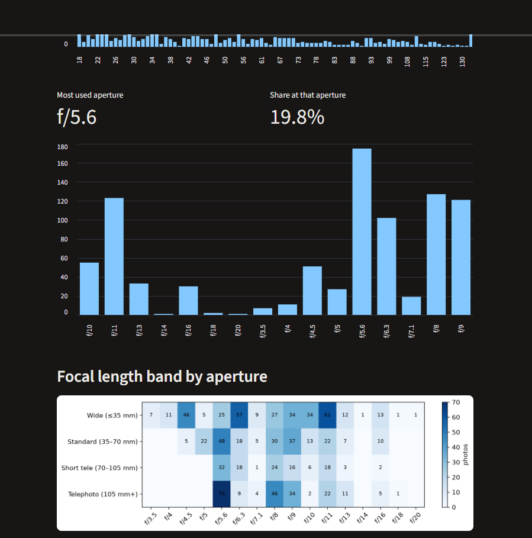
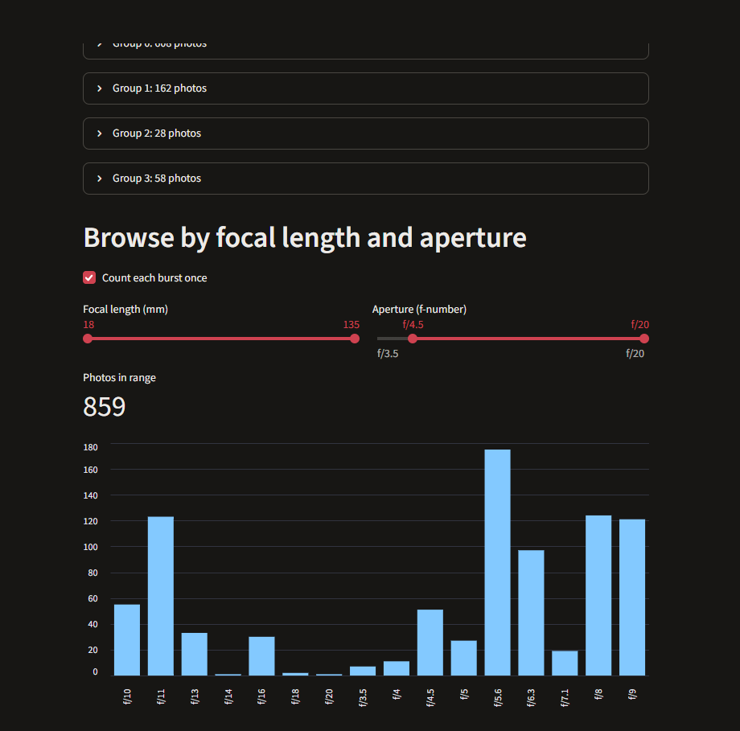
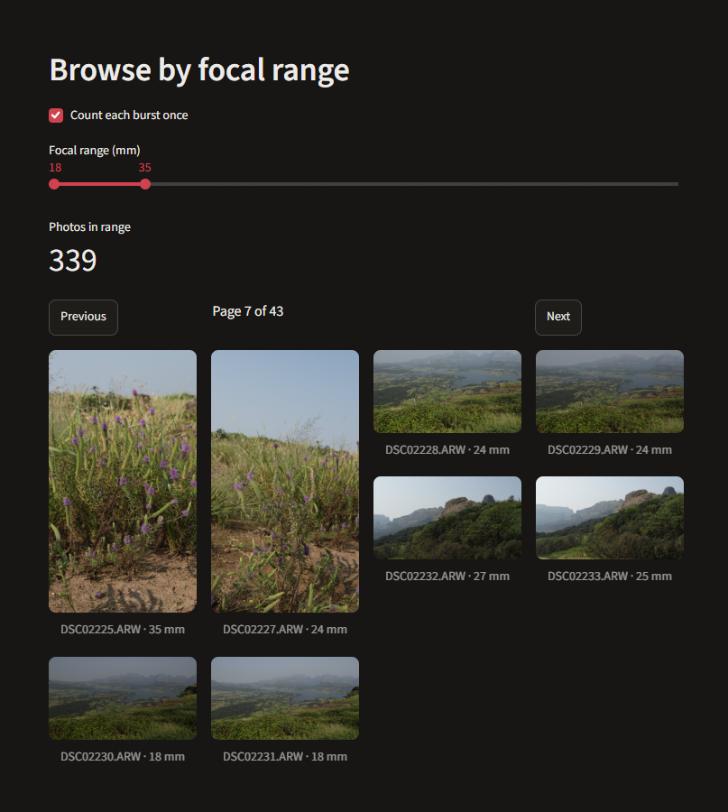

# Get Raw Image Information

**Find out which focal lengths and apertures you really shoot with, and browse your photos by both, without loading a single RAW file.**

Point it at a folder of Sony `.ARW` (or `.JPG`) photos. It reads the camera metadata with `exiftool`, shows your most-used focal lengths and apertures, groups focal lengths into clusters, and lets you filter by focal length and aperture together to view the matching photos.


## Quick start

Requirements: Windows (or any OS with `exiftool` on the PATH), [uv](https://docs.astral.sh/uv/), Python 3.13 (uv installs it).

```powershell
uv sync
uv run streamlit run app.py -- D:\DCIM
```

Then open the URL Streamlit prints. The folder argument is the default directory shown in the app. Change the directory and subfolder depth in the app to scan other folders.

Print the focal length of every image in a folder from the command line:

```powershell
uv run python get_focal_length.py D:\DCIM --depth 1
```

## What you can do with it

**Lens habits and apertures**

- **See your real lens habits.** A histogram of focal lengths, the most-used focal length, and its share of your photos.
- **See which apertures you use.** The most-used f-stop, a bar chart per f-stop, and a heatmap of focal length band by f-stop.
- **Count bursts as one shot.** Frames taken in the same second are collapsed into one, so a 10-frame burst does not skew the numbers.
- **Find your shooting "modes" automatically.** DBSCAN groups focal lengths that cluster together (for example, a 18–35 mm wide-angle group and a 130–135 mm telephoto group), with photo counts and shares.

**Browsing**

- **Filter by focal length and aperture together.** Drag the focal length slider to 100–120 mm and the aperture slider to f/5.6–f/8, then page through the matching photos, eight at a time. Each thumbnail shows its file name, focal length and f-number.
- **Look at the photos as they were shot.** Thumbnails are rotated upright from the camera's own orientation tag, including portrait shots.
- **Open any photo full screen.** Use the expand icon in the corner of a thumbnail; press Esc to return.
- **Copy a photo's file path.** Use the copy icon in the corner of a thumbnail to paste the path into another tool.
- **Stay fast on big folders.** Metadata is cached for a day. Thumbnails come from each RAW's embedded JPEG preview (no RAW decoding), are cached on disk, and load in the background near the page you are viewing, within a 2 GiB memory cap.









## How it works

| Piece | Role |
|---|---|
| `get_focal_length.py` | Runs `exiftool` in one batch per folder: focal length, timestamps, orientation, f-number and the embedded preview JPEG. |
| `focal_data.py` | Loads one row per image, caches it in `.cache/` for a day, groups bursts, shares the focal bands, and filters by focal length and aperture range. |
| `app.py` | Streamlit dashboard: focal length and aperture statistics, DBSCAN groups, and the browser. |
| `viewer/` | Browser backend: paging, thumbnail generation and disk cache, memory-capped background buffer, and the Streamlit section. |
| `notebooks/` | Notebooks 01–07 for the data analysis below. |

Key choices:

- **Preview, not RAW.** A Sony `.ARW` file embeds a 1920×1080 JPEG. Reading that takes milliseconds, while decoding the RAW takes seconds.
- **Orientation from the RAW tags.** The embedded preview has no EXIF block, so the orientation is read from the RAW and applied to the thumbnail.
- **Fail fast, with one exception.** A bad value (orientation, focal length, f-number) or an unreadable preview raises an error. An image without a mandatory tag is skipped with a logged warning that names the file and the missing tag, so one edited JPEG does not stop a folder from loading.

## Tested with

Hardware and software:

- Windows 11, Python 3.13 (managed by uv)
- exiftool 13.63
- Pillow 13.0.0, Streamlit 1.67.0, pandas, scikit-learn (DBSCAN and HDBSCAN)

Data:

- A real photo collection of about 885 Sony `.ARW` and `.JPG` files in nested folders, scanned at subfolder depth 1 (877 bursts after grouping).
- Orientation tags over the collection: 547 normal, 335 rotated 270° CW, 3 rotated 90° CW, and 1 image without camera metadata (an edited JPEG, skipped with a warning).

Checks that were run:

- The CLI on the real folder.
- The record cache: a fresh scan, a cache hit, and a rebuild when the settings change.
- Aperture: 885 records with an f-number on every one, 16 distinct f-stops, 877 bursts.
- Burst grouping and the focal length and aperture filter (both ranges inclusive).
- The app under Streamlit's `AppTest` on the real folder: default view, a 100–120 mm range (51 bursts), paging with Next, and the combined filter 100–120 mm with f/5.6–f/8, which gives 36 photos, equal to an independent pandas mask. Every caption on the page is inside both ranges.
- The app's aperture statistics against pandas: most-used f/5.6 at 19.8% of photos.
- Thumbnails of two rotated RAW files checked against their orientation tags: upright portrait output at 450×800.
- The thumbnail buffer with a fake loader and a small cap: the cap is never exceeded, the nearest photos load first, the farthest are evicted first, the visible page is never evicted, and a background error is re-raised.
- Notebooks 01–07 executed end to end with exit code 0.

Not done yet:

- No automated test suite is committed. The checks above were run as scratch scripts.
- The memory plateau at the 2 GiB cap has not been measured while paging through the whole folder in a browser.
- The thumbnail tile's buttons (copy, full screen, Esc) have not been clicked through in a browser. Automated checks cover only that the tiles render.
- The three rotated-90° photos have not been checked by eye.

## Known limits

- **DBSCAN at `eps` 3 mm chains nearby focal lengths.** On the test collection, the default settings merge 18–83 mm into one large group. Use the notebooks to pick a different `eps` or switch to HDBSCAN.
- **Bursts are grouped by identical timestamps.** A burst that crosses a second boundary is split. Two single shots in the same second are merged.
- **A burst's aperture is its first frame's.** Frames in one burst can have different f-numbers, and only the first is used.
- **The lens limits in notebook 07 are references.** The f/3.5 and f/5.6 lines come from the lens name (18–135 mm F3.5–5.6), not from the photos. The per-photo `MaxApertureValue` tag would give the exact limit, and is not read yet.
- **Cold thumbnails are slow.** Building one thumbnail takes about 0.36 s, mostly `exiftool` start-up. The disk cache makes later views fast.
- **Copying needs a secure page.** The copy icon uses the browser clipboard, which works on `localhost` or HTTPS. Over plain HTTP from another machine it tries a text-selection copy, which some browsers block; a failure is shown under the photo.

## Project layout

```
app.py                 Streamlit dashboard
get_focal_length.py    exiftool wrapper and CLI
focal_data.py          records, cache, burst grouping, focal and aperture filter
viewer/                photo browser (paging, thumbnails, buffer, UI)
notebooks/             01–07 analysis notebooks
images/                screenshots for this README
```

Caches are written to `.cache/` and `viewer/.cache/` and are ignored by git.

## Data analysis

The notebooks in [`notebooks/`](notebooks/) hold the analysis behind the app's defaults. Each one reads the same folder through `focal_data.py`, and each has a takeaways section with figures from the run (885 images, 877 bursts). They describe that folder only.

**Choosing the DBSCAN `eps`** (notebooks 01–04):

- [01 k-distance elbow](notebooks/01_k_distance_elbow.ipynb): the elbow suggests `eps` 2.00 mm (`min_samples` 20).
- [02 density valleys](notebooks/02_density_valleys.ipynb): the lowest density valley is at 107.7 mm. The KDE bandwidth of 11.16 mm is a smoothing scale, not an `eps` candidate.
- [03 largest gap](notebooks/03_largest_gap.ipynb): the largest gaps fall at 104.0 mm and 120.0 mm, and the Tukey fence suggests `eps` 3.00 mm.
- [04 HDBSCAN](notebooks/04_hdbscan.ipynb): suggests `eps` 3.00 mm, finds 11 clusters and 87 noise photos. Examples: 121–135 mm (165 photos), 18 mm (164), 59–80 mm (95).

**Focal length distribution** (notebook 05):

- [05 distribution](notebooks/05_distribution.ipynb): across 877 bursts the median is 49 mm and the middle half spans 24–99 mm. Shares by band: wide (≤35 mm) 38.7%, standard (35–70 mm) 24.7%, short tele (70–105 mm) 13.7%, telephoto (105 mm+) 22.9%. The 18 mm (18.4%) and 135 mm (17.9%) peaks are the most common single focal lengths. Merging bursts shifts any band share by at most 0.2 percentage points.

**Aperture** (notebooks 06–07):

- [06 aperture distribution](notebooks/06_aperture_distribution.ipynb): 16 f-stops in use. f/5.6 is the most used at 20.0% of bursts. Mid (f/5–f/8) is 50.4%, stopped down (f/9 and narrower) 41.7%, and wide (f/4.5 and wider) 7.9%.
- [07 aperture vs focal length](notebooks/07_aperture_vs_focal.ipynb): wide openings appear only at short focal lengths. 18.9% of bursts in the wide band were at f/4.5 or wider, against 2.3% in the standard band and none at 70 mm or longer. The median f-number is f/8 in every band.
